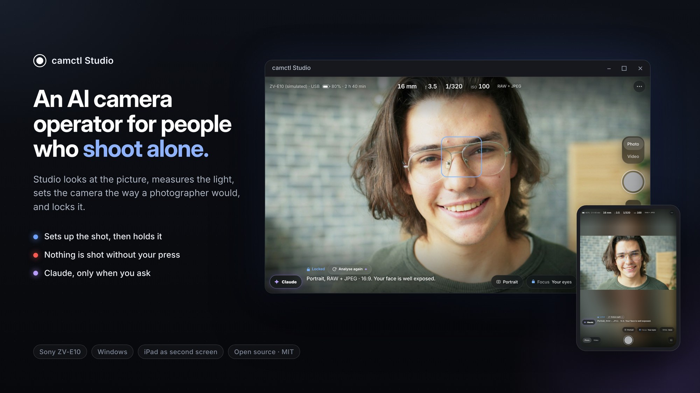
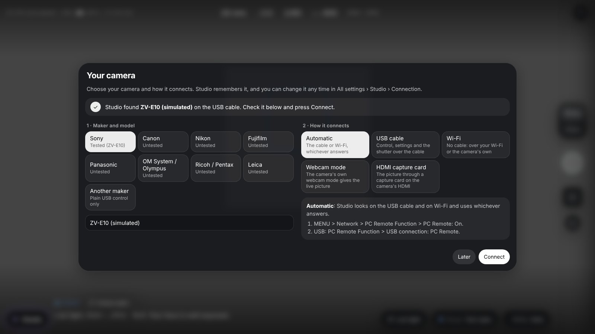
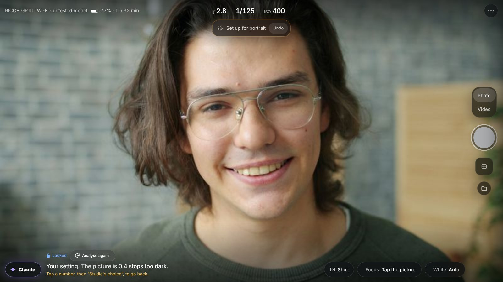

# camctl Studio

**Turn your camera into a professional studio, run by AI.**

camctl Studio sets up and operates your camera the way a professional photographer would, so you can concentrate on
what is in front of it: portraits, products, talking-head video, shorts and video calls. Studio (with Claude, if you add your key)
looks at the picture, measures the light, sets exposure, focus, white balance and the file format, and then **locks**
everything. After that nothing changes by itself; you decide when something changes.

The screens come from Studio's built-in simulator. The person is an example photo by
[Vitaly Gariev on Unsplash](https://unsplash.com/photos/young-man-with-glasses-smiles-at-the-camera-xhQUcSQpotU),
standing in for the camera's picture. All photos used: [photo credits](docs/photo-credits.md).

**New here?** The [visual guide](docs/guide.md) shows every screen and how to use it, step by step.

**Status: useful, and early.** Tested on one camera. Photos, focus, exposure setup, saved setups and focus stacking
work on that camera; video recording from the app is being verified after the latest fix.

**Formats:** every format the camera offers can be chosen in All settings › Camera › Format (photo file, JPEG
quality, image size, aspect ratio, picture profile; video file, frame rate and quality, picture profile), and Studio
exposes for the one in use. Verified on the real camera so far: RAW + JPEG photos and the S-Log3 video setup. The other
formats are built and tested on a simulated camera and still to be confirmed on the ZV-E10.

**Sound:** a ten-second sound check before a take (More › This shoot › Sound check) listens through the laptop's
microphone, not the camera's, so check the camera's own level on its screen. After the card import each clip gets a
short sound report (loudness, clipping, background noise, long pauses), made from the copy in your shoot folder.

**Looks:** six film-style looks of our own (More › Looks), only when you choose one: as a marked preview on the live
picture (off every time Studio starts) or as a new copy of a finished photo or clip in your shoot's LOOKS folder.
The camera's files are never changed; photos get the look from the camera's JPEG (the RAW file is left as it is).

**Playground (experiments):** More › Playground. Each experiment is off until you switch it on and may change; every
photo is your own press, results are new files in your shoot's PLAYGROUND folder, and your photos are never changed.
- Day reel: Studio keeps the last 3 seconds of the live picture and saves them as a small silent clip when you take a
  photo, then joins the day's clips and photos into one video (the clips come from the live picture, so they are small;
  the photos in the reel are full quality).
- Double exposure: two of your photos blended into one, with the first as a ghost over the live picture.
- Paint with light: a real long exposure (10 / 20 / 30 s) set up only when you press Apply, plus a small "Practice"
  version from the live picture. Long exposures over the cable are not yet checked on the ZV-E10.
- Shoot for a mood: Claude suggests settings, framing and light for a mood you describe (one question per press,
  nothing changes until you press Apply).
- Focus pull: focus glides between two points you tap, at the speed you choose. Not yet checked on the real camera.

## Capture card (optional, not yet tested on real hardware)

With an HDMI capture card (for example an Elgato Cam Link) Studio can show the camera's HDMI picture as the live
picture, at its full size and exactly as the camera sends it, and record it with its sound into your shoot's VIDEO
folder on the laptop. Camera control stays on the USB cable or Wi-Fi. Choose it in All settings › Camera › Picture
source, and "Record video to: This laptop" under Saving. The picture pauses for about a second when a recording on the
laptop starts and stops. Nothing is opened until you pick the device by name; a webcam is never opened by itself.

1. An HDMI cable from the camera to the capture card.
2. The capture card into the laptop.
3. On the camera, switch the HDMI information display off so the picture is clean (Studio does not change the
   camera's menu).

It is not known yet whether the ZV-E10 keeps sending HDMI while PC Remote is on. If you own a capture card, please
tell us whether it works through the usual issue form (All settings › Studio › Check this camera › Share).

## Tested with

- **Sony ZV-E10, firmware 2.03, on a Windows laptop.** Nothing else is tested yet.
- Other Sony cameras are **untested**. "Check this camera" (All settings › Studio) tests, without taking a photo, what
  works on yours and what to change.
- **Canon EOS, Nikon and other makers: new and untested.** Studio has drivers for Canon EOS / EOS R and Nikon
  (settings, live picture, photo, video, focus over the USB cable or Wi-Fi), Wi-Fi drivers for Fujifilm, Panasonic
  LUMIX, OM System / Olympus and Ricoh / Pentax, and plain PTP over USB for other makers (settings and the shutter).
  They were written from public protocol notes and tested only against simulated cameras.
  Details, and what each route can do: [docs/cameras.md](docs/cameras.md).

## Your camera, any maker

The first time Studio starts it asks for **your camera**: the maker, the model if you like, and how it connects
(automatic, USB cable, Wi-Fi, the camera's webcam mode or an HDMI capture card). It shows only the ways that maker
allows, with its setup steps, and marks everything untested that is untested. You can change it later in
All settings › Studio › Connection.

## Help add your camera

If you have a camera that is not in the table below, you can help, in about two minutes:

1. Connect your camera to Studio (USB or Wi-Fi).
2. Open All settings › Studio › **Check this camera** and press it. No photo is taken; Studio changes a few settings to
   a neighbouring value and back, and puts everything back as it was.
3. Press **Share**. Your browser opens a prefilled GitHub issue; read it, drag the report file onto the page, and press
   Submit yourself. Nothing is sent without your press.

The report contains: the app version, the camera's brand, model and firmware, the connection type, which functions
worked, the camera's own list of settings and allowed values, and timings. Studio removes the serial number, any names
you gave the camera, network details, paths and pictures before you see it. Every shared report is read, and a camera
is added to this table when it works.

## Tested cameras

| Camera | Firmware | Connection | Status | Since |
|---|---|---|---|---|
| Sony ZV-E10 | 2.03 | USB and Wi-Fi | tested by the author | November 2026 |

## What you need

- A Windows laptop with Python 3.12 (from python.org).
- The camera, and either Wi-Fi (no driver needed) or a USB cable.
- Your own Claude key from console.anthropic.com (optional: without it Studio uses its own built-in setup and the
  Claude features stay off). Studio asks for it in the app; it is never part of this project.
- Studio asks Claude Opus 5.5. You can choose Claude Fable 5.2 (most capable, slower, about twice the cost) in
  All settings › Studio › Claude; if your key cannot use Fable, Studio answers with Opus 5.5 and says so.

## Install

1. Download this project (green "Code" button › Download ZIP) and unpack it.
2. Install Python 3.12 from python.org (the default "Install for me" option).
3. Double-click **"Install or repair camctl Studio.cmd"**. It installs exactly what `requirements.txt` lists, for your
   Windows user only, from pypi.org. No admin rights, no system changes; it ends with "DONE".
4. Set up the camera as Studio's guide shows when you connect it. For the ZV-E10 over Wi-Fi: MENU › Network ›
   PC Remote Function › PC Remote: On, connection method Access Point; the first time choose Pairing on the camera.
5. Start Studio: double-click `tools\studio_app.pyw`, or run `start_studio.ps1`. Studio opens in its own window.

USB note: on Windows the camera's USB connection may need a driver that Studio never installs itself. Wi-Fi needs none.

Other makers over Wi-Fi (Canon, Nikon, Fujifilm, Panasonic, OM System / Olympus, Ricoh / Pentax): choose the maker
and Wi-Fi on the **Your camera** screen (or All settings › Studio › Connection › Wi-Fi). These routes are **untested on real cameras** (written from public
protocol notes, tried on simulated cameras only); see [docs/cameras.md](docs/cameras.md).

## Recommended setup

1. A dummy battery / mains adapter in the battery slot (for the ZV-E10 the AC-PW20 type): live view drained about half
   the battery per hour, and the camera cannot run from USB without a battery.
2. The USB cable instead of Wi-Fi when you can: about 25 frames per second of live view instead of 12-17, and photos
   arrive faster.
3. A tripod: saved setups and "Line up" need the camera to stay in place.
4. One soft light at about 45 degrees to your face: much lower ISO (less noise) indoors.
5. A variable ND filter only outdoors or in bright light, with "ND filter on the lens" switched on in Studio: indoors it
   forces a very high ISO.

## iPad as a second screen

Run `start_studio.ps1 -Lan` on the laptop. The first start asks you to choose a PIN. Allow Studio on your *private*
home network only, for example with this one line in an administrator PowerShell (your choice, Studio never changes
firewall settings itself):

    New-NetFirewallRule -DisplayName "camctl Studio iPad" -Direction Inbound -Protocol TCP -LocalPort 8770 -Profile Private -RemoteAddress LocalSubnet -Action Allow

Then open the address Studio shows (All settings › Studio) on the iPad and enter the PIN. The Claude key can only be
entered on the laptop. Starting Studio normally again makes it laptop-only again.

## What Studio never does

- It never takes a photo or starts a recording without your press.
- It never changes a setting by itself after it locked; suggestions wait for your tap.
- It never sends anything in the background: Claude is only asked when you press a Claude button, and a camera report
  is only shared if you submit it yourself.
- It never installs drivers, never changes firewall or network settings, never deletes anything on the card.
- The sound check never records or saves sound; only its numbers go to Claude, and only when you press the Claude
  button under the result.
- Your Claude key is stored encrypted for your Windows user, never shown again and never logged.

## For developers

`python -m pytest tests` runs the tests on a simulated ZV-E10 (no camera needed). `tools/sim_studio.py` starts Studio
on the simulator. `tools/publish.py --check` makes sure nothing personal would be published. A second camera brand
plugs in at `camctl/drivers` (see `drivers/base.py` for the functions Studio needs). See CONTRIBUTING.md.

## Licence

MIT, see [LICENSE](LICENSE).
