# camctl Studio: the visual guide

How to use Studio, screen by screen. For installing it, see the [README](../README.md#install).

> The screenshots come from Studio's built-in simulator. The person in them is an example photo (by
> [Vitaly Gariev on Unsplash](https://unsplash.com/photos/young-man-with-glasses-smiles-at-the-camera-xhQUcSQpotU))
> standing in for the camera's picture; with your camera connected you see its live picture there. Claude's answers in
> the screenshots are made up by the simulator and say so.
> The pictures on the cards and in Looks are stock photos too: see the [photo credits](photo-credits.md).

**Contents**

1. [Start and connect](#1-start-and-connect)
2. [The main screen](#2-the-main-screen)
3. [Let Studio set up the shot](#3-let-studio-set-up-the-shot)
4. [Change a value yourself](#4-change-a-value-yourself)
5. [Take a photo](#5-take-a-photo)
6. [Record video](#6-record-video)
7. [Ask Claude](#7-ask-claude)
8. [More: tools for the shoot](#8-more-tools-for-the-shoot)
9. [Special shots](#9-special-shots)
10. [Looks and Playground](#10-looks-and-playground)
11. [All settings](#11-all-settings)
12. [Shoot folder and hand-off](#12-shoot-folder-and-hand-off)
13. [The iPad as a second screen](#13-the-ipad-as-a-second-screen)
14. [What Studio never does](#14-what-studio-never-does)

---

## 1. Start and connect

Switch the camera on, connect it by USB cable or Wi-Fi, and start Studio (`tools\studio_app.pyw` or
`start_studio.ps1`). Studio opens in its own window and shows **Getting ready**.

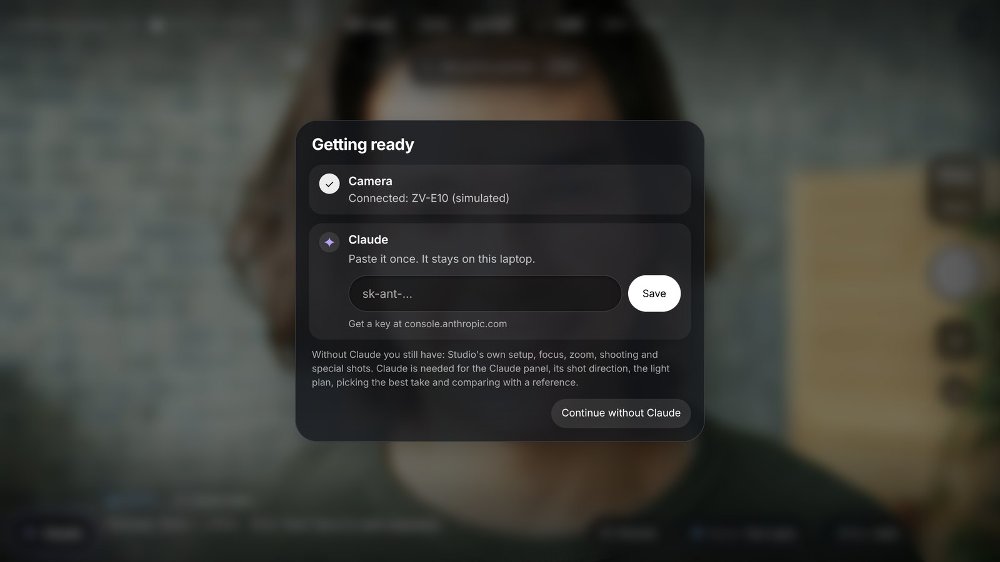

- **Camera** shows what is connected. If the camera needs a setting changed first, Studio shows the steps for your
  model.
- **Claude** is optional. Paste your own key once (it stays on this laptop, encrypted for your Windows user), or press
  **Continue without Claude**. Without a key you still have Studio's own setup, focus, zoom, shooting and the special
  shots.

No camera at hand? `python tools/sim_studio.py` starts Studio on a simulated camera. Its picture is a plain drawn test
card; for this guide the example photo was put in its place.

## 2. The main screen

Everything you need while shooting is on one screen. The picture is exactly what the camera sends; overlays only
appear when you switch them on.

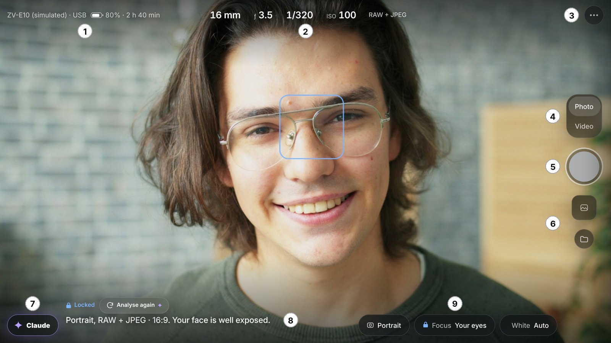

| | What it is | What it does |
|---|---|---|
| 1 | Connection and battery | The camera, how it is connected, and the battery with the time left. |
| 2 | The values in use | Zoom, aperture, shutter, ISO and the file format. Tap one to change it. |
| 3 | More | Everything else: exposure and focus aids, takes, teleprompter, special shots, Looks, Playground, All settings. |
| 4 | Photo / Video | Switches the mode. Studio sets the camera up again for the new mode, then locks. |
| 5 | The button | Takes a photo, or starts and stops a recording. Nothing is shot without your press. |
| 6 | Latest photo and shoot folder | Opens the last photo, and the shoot folder with the hand-off to your editor. |
| 7 | Claude | Opens the Claude panel. Claude is only asked when you press. |
| 8 | Status line | What Studio set and why, in one sentence. **Locked** means nothing changes by itself any more. |
| 9 | Shot, focus and white balance | The kind of shot Studio is exposing for, the focus target, and the white balance. |

The colours mean the same everywhere: **blue** is locked, **red** is recording, **amber** is a warning, and
**violet** is Claude.

## 3. Let Studio set up the shot

When the camera connects, Studio looks at the picture, measures the light, and sets aperture, shutter, ISO, focus and
the file format the way a photographer would for this kind of shot. Then it **locks**: the status line shows a blue
lock and the reason for the choice.

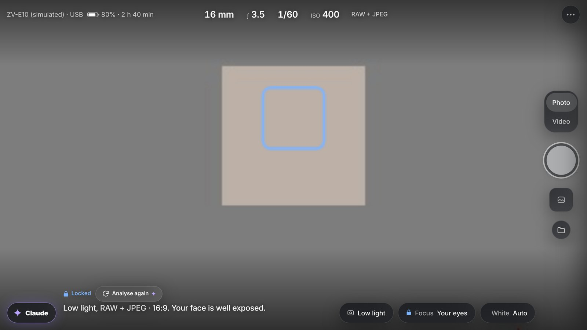

After that nothing changes by itself. If the light changes, Studio only suggests something, and waits for your tap:
you see the suggestion next to the Claude button with its buttons below.

Tap the shot pill (here **Portrait**) to tell Studio what you are shooting. It marks the kind of shot it sees itself.

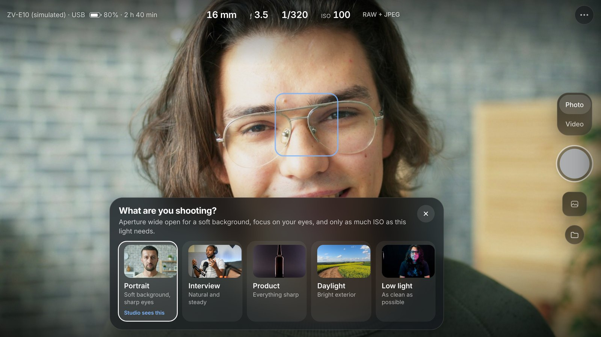

**Analyse again** (next to the lock) measures the light again, sets every value back to Studio's choice, and locks.

## 4. Change a value yourself

Tap a value at the top. A tray opens with every value the camera allows, and one line that says what the current
choice is good for.

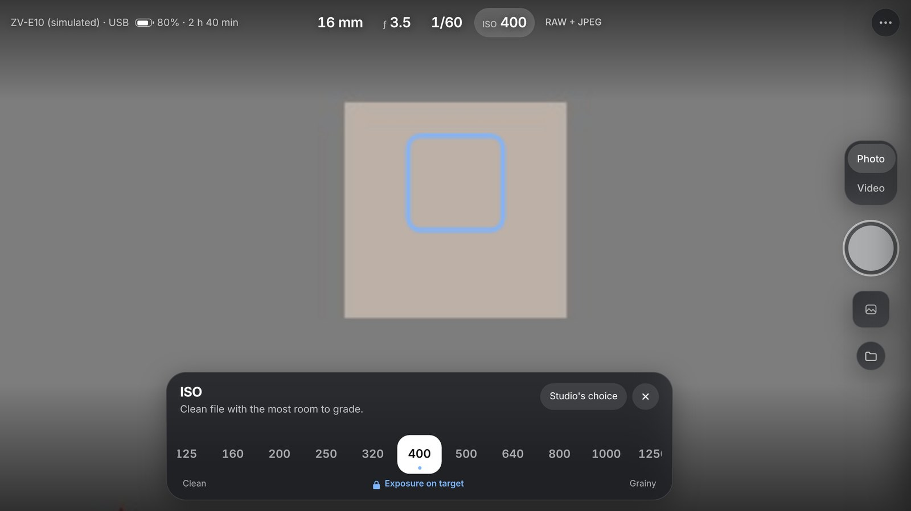

- Pick a value and it is set on the camera and held.
- **Studio's choice** gives the value back to Studio.

White balance has its own pill at the bottom right. Until it is measured it is on auto; **Find it automatically** looks
for neutral surfaces in the picture, **Use a grey card** is the most precise. Once measured it is locked.

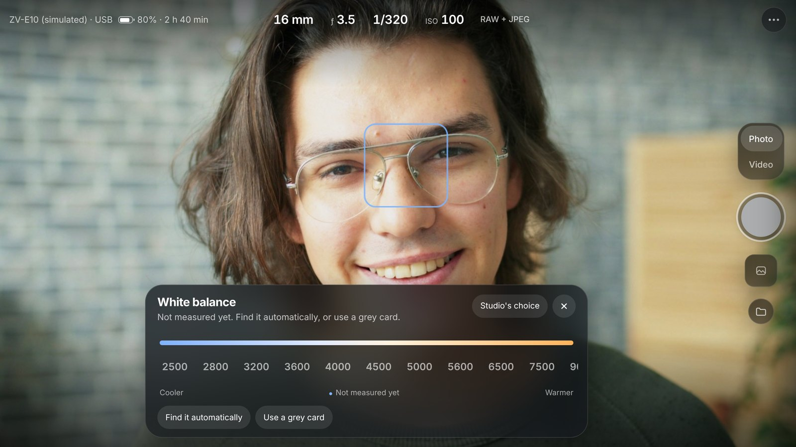

**Focus:** tap the picture where it should be sharp. Studio focuses there once and then holds; press the focus pill to
focus on the target again.

## 5. Take a photo

Press the button. The photo arrives on the laptop and Studio shows it straight away, with what was saved and a first
check (exposure, sharpness, noise).

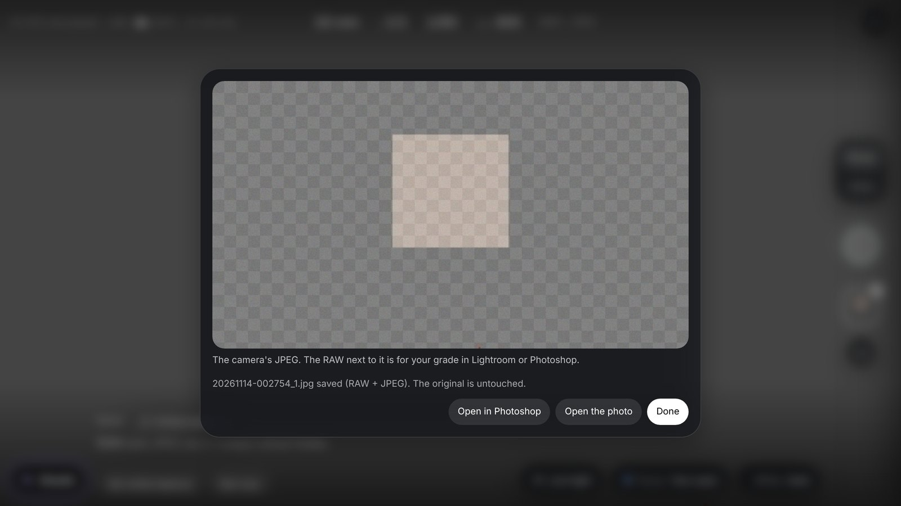

- **Done** takes you back to shooting.
- **Open the photo** shows it large.
- **Open in Photoshop** opens the file there, if Photoshop is installed.

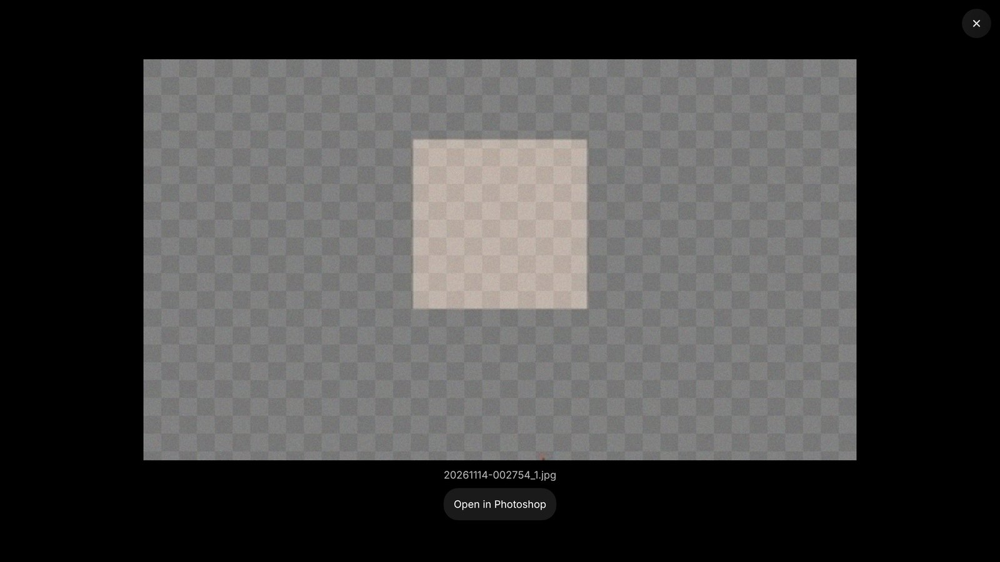

With RAW + JPEG you look at the camera's JPEG; the RAW next to it is untouched and waits for your edit.

## 6. Record video

Switch to **Video**. Studio sets the camera up for video (here S-Log3, 4K 25p) and locks again. The status line names
the format in use.

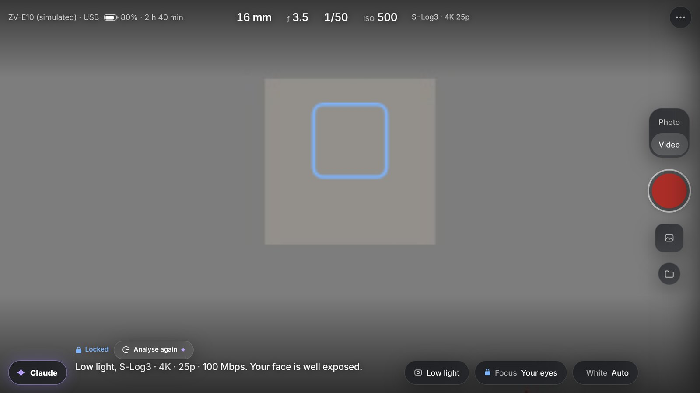

Press the button to record. The timer at the top left turns red, and every setting is held until you stop.

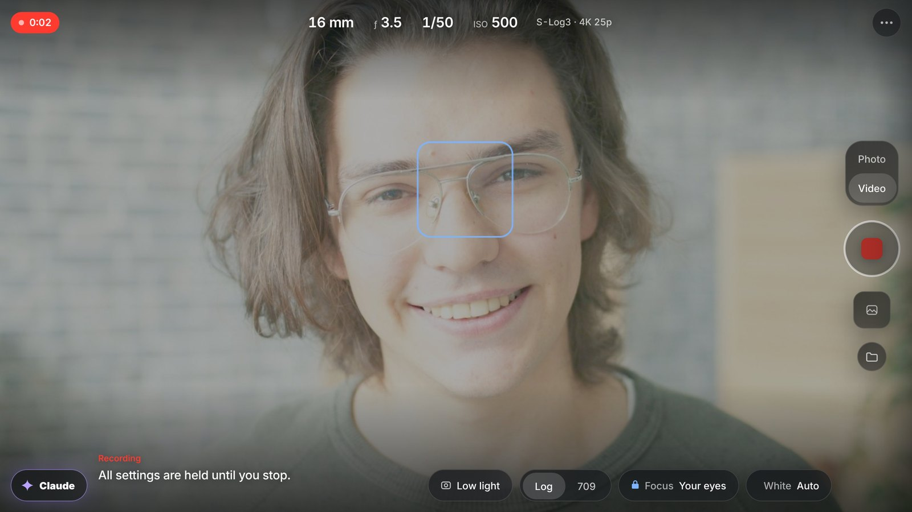

The clip is saved on the camera's card. Afterwards **More › Import from card** copies it into your shoot folder (the
card is only read, never changed) and adds a short sound report for each clip.

With S-Log3 a **Log / 709** switch appears at the bottom: it only changes how the picture is shown in Studio so you can
judge it, never the recorded file.

## 7. Ask Claude

Press **Claude**. Write what you want in your own words, tap one of the suggestions, or pick a card.

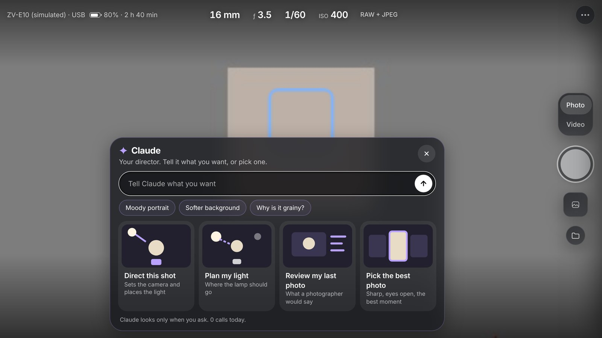

- **Direct this shot** sets the camera for what you describe and tells you where the light should go.
- **Plan my light** opens the Lighting Lab: add reference pictures and Claude plans your light for that look.
- **Review my last photo** (or take) says what a photographer would say about it.
- **Pick the best photo** compares your takes.

The cards change with the mode and with the tool you have open. Claude answers in plain language, and anything it
wants to change waits for your **Apply**.

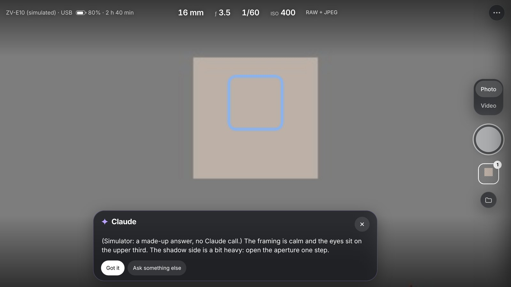

Claude is asked once per press, never in the background, and the panel counts the calls of the day. It needs your own
key from console.anthropic.com; Studio uses Claude Opus 5.5 unless you choose another model in
All settings › Studio › Claude.

## 8. More: tools for the shoot

The **…** button at the top right.

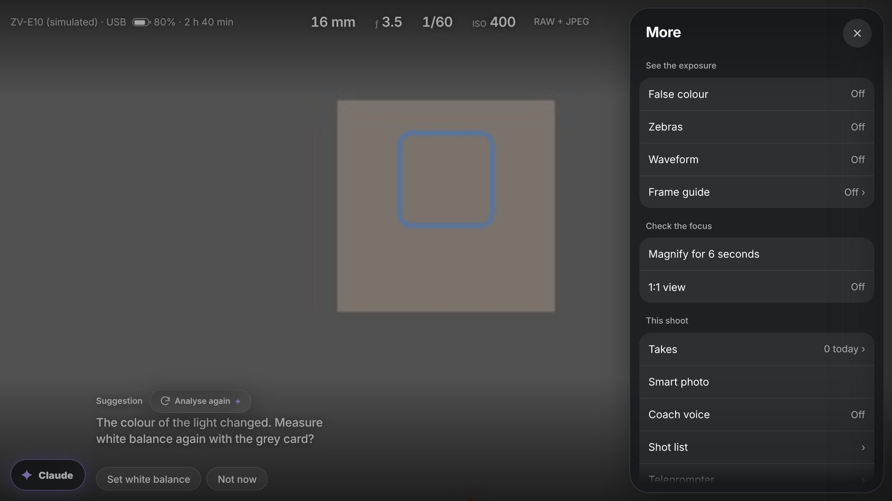

- **See the exposure:** false colour, zebras and a waveform over the picture, and a **Frame guide** (9:16, 4:5, 1:1,
  16:9, 2.35:1). They are marked overlays on the screen only; the photo or video is recorded full size without them.
- **Check the focus:** magnify for six seconds, or a 1:1 view.
- **This shoot:** your takes, the shot list, the teleprompter, the sound check and the import from the card.

**Teleprompter:** paste your script, or give Claude a topic and a length and let it write one. The text scrolls while
you record.

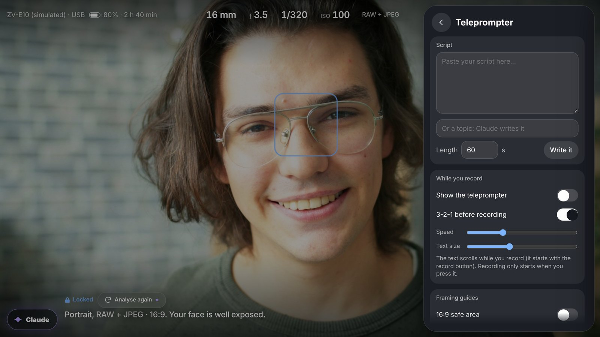

**Sound check:** ten seconds through the laptop's microphone (four quiet, six speaking) to catch noise and levels
before a take. Nothing is recorded or saved. Studio cannot hear the camera's own microphone, so check the camera's
level on its screen.

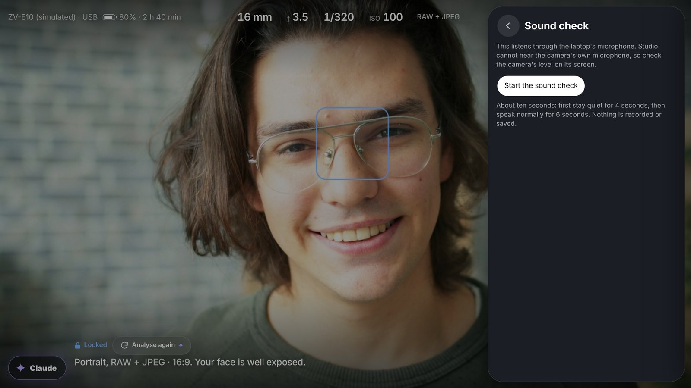

## 9. Special shots

Further down in More.

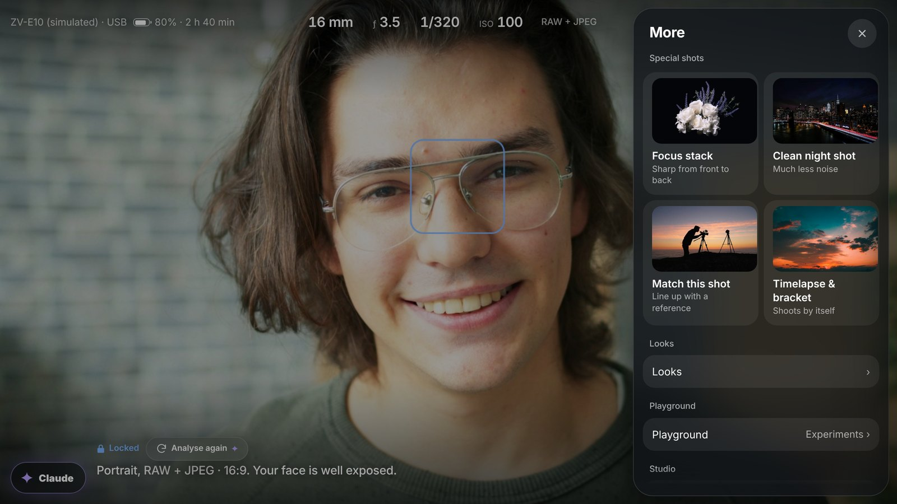

- **Focus stack:** several photos from near to far, merged into one image that is sharp from front to back. For
  products and close-ups, on a tripod. **Check the object** finds the near and far point without taking a photo.
- **Clean night shot:** 8 or 16 photos in a row, lined up and averaged, for much less noise.
- **Match this shot:** line the camera up with a reference picture.
- **Timelapse & bracket:** a series that runs by itself once you press Start.

Each sheet says how long it takes and what is kept before you start.

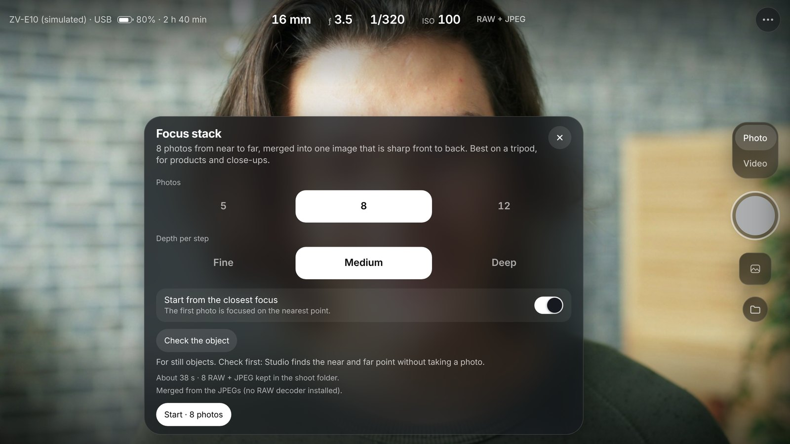

## 10. Looks and Playground

**Looks** (More › Looks) are six film-style looks. Nothing is marked until you pick one. A look is only ever a marked
preview on the live picture, or a new copy of a finished photo or clip in your shoot's LOOKS folder. Your camera files
are never changed.

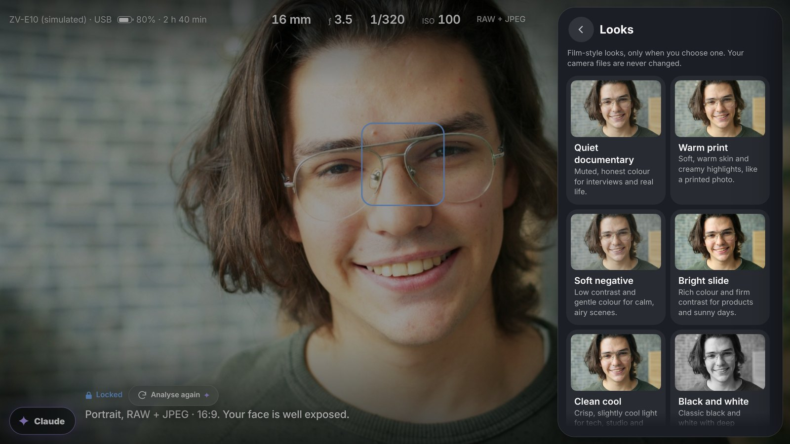

**Playground** (More › Playground) holds experiments: day reel, double exposure, paint with light, shoot for a mood,
focus pull. Each one is off until you switch it on, each photo is still your own press, and the results are new files
in your shoot's PLAYGROUND folder.

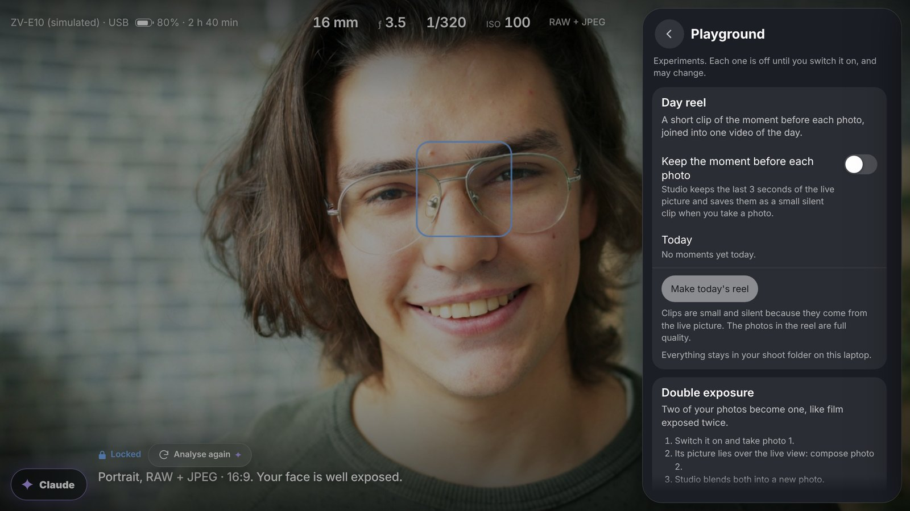

## 11. All settings

More › **All settings** has four tabs.

**Camera:** every exposure value, the ND filter switch, focus mode and area, and the **Format**: photo file, JPEG
quality, image size, aspect ratio, picture profile, and for video the file, frame rate, quality and picture profile.
Studio exposes for the format you choose.

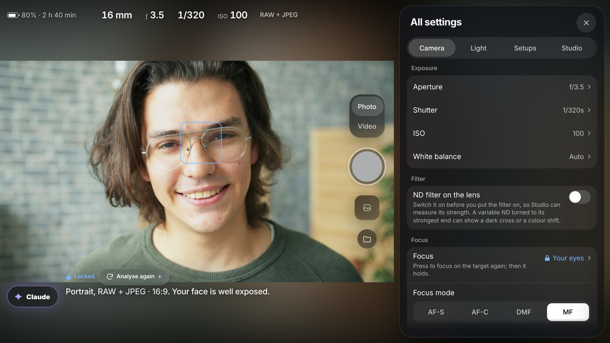

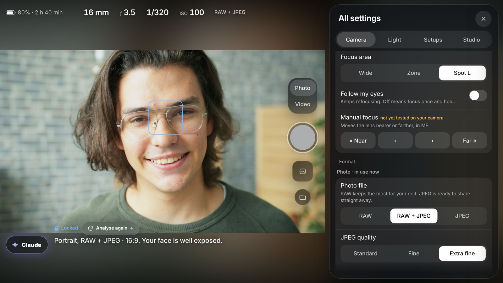

**Light:** what Studio measures in your light (where the main light comes from, contrast on the face, brightness,
background, mixed colours, flicker) and the Lighting Lab. Nothing here changes the camera by itself.

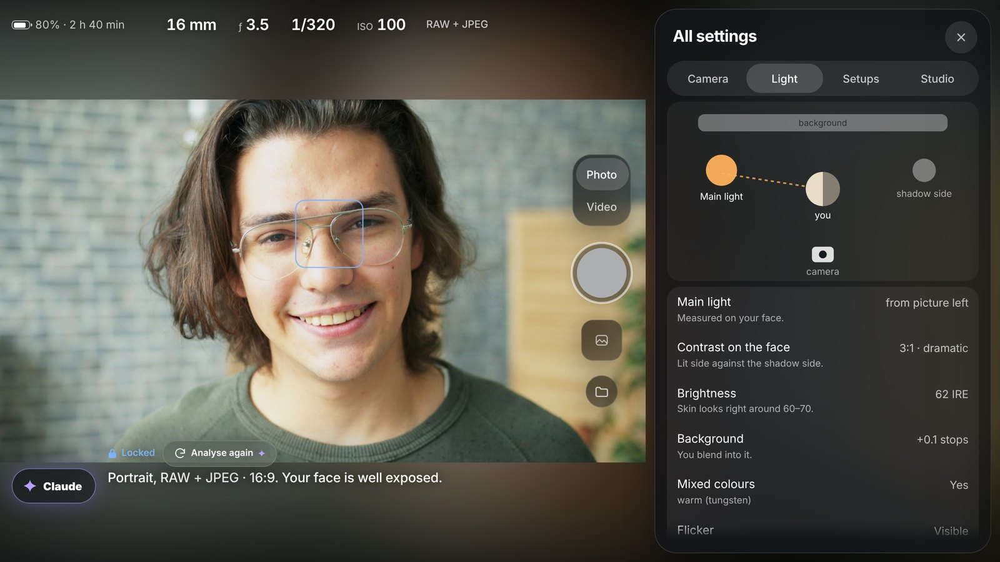

**Setups:** save the whole setup under a name (every value, the zoom, the light, a clean picture of the frame and your
notes) and come back to it another day. **Line up with the last take** helps you put the camera back in the same place.

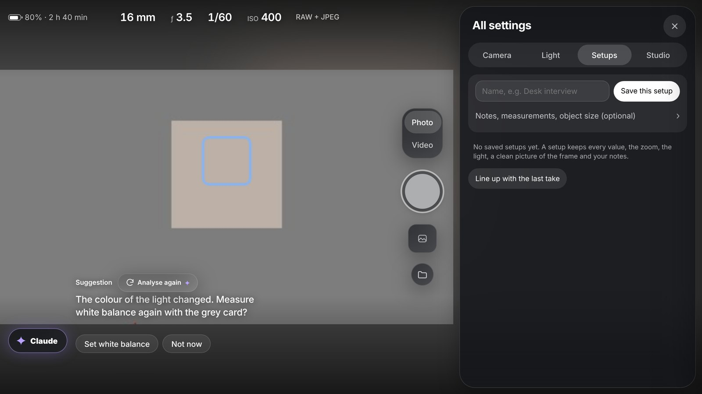

**Studio:** the connection (automatic, USB cable or Wi-Fi), the iPad, your camera model and battery, **Check this
camera**, the history of what Studio changed with **Undo**, the Claude model and key, and shortcuts.

## 12. Shoot folder and hand-off

The folder button opens **Shoot & hand-off**. A shoot is one folder on the laptop for everything from one session.

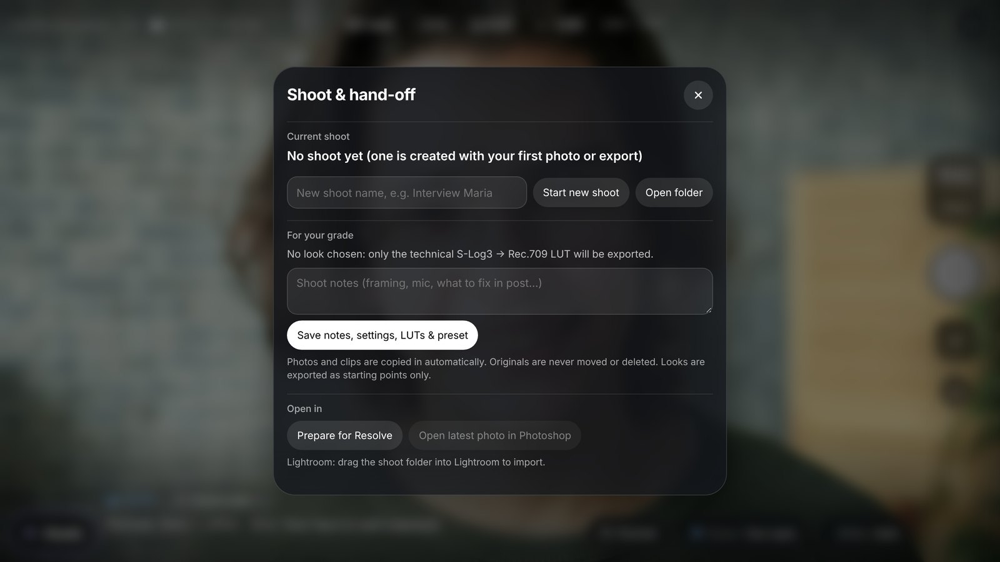

- Name a new shoot or open the folder.
- Write notes for your edit and save them with the settings and the technical LUT (S-Log3 to Rec.709).
- **Prepare for Resolve** or open the latest photo in Photoshop. For Lightroom, drag the shoot folder in.

Photos and clips are copied in; originals are never moved or deleted.

## 13. The iPad as a second screen

Studio can be opened on an iPad on your home network, for example to see yourself from in front of the camera. It is
off until you turn it on, and it asks for a PIN; the [README](../README.md#ipad-as-a-second-screen) has the steps.

Upright, the controls move to the bottom and More opens from the bottom.

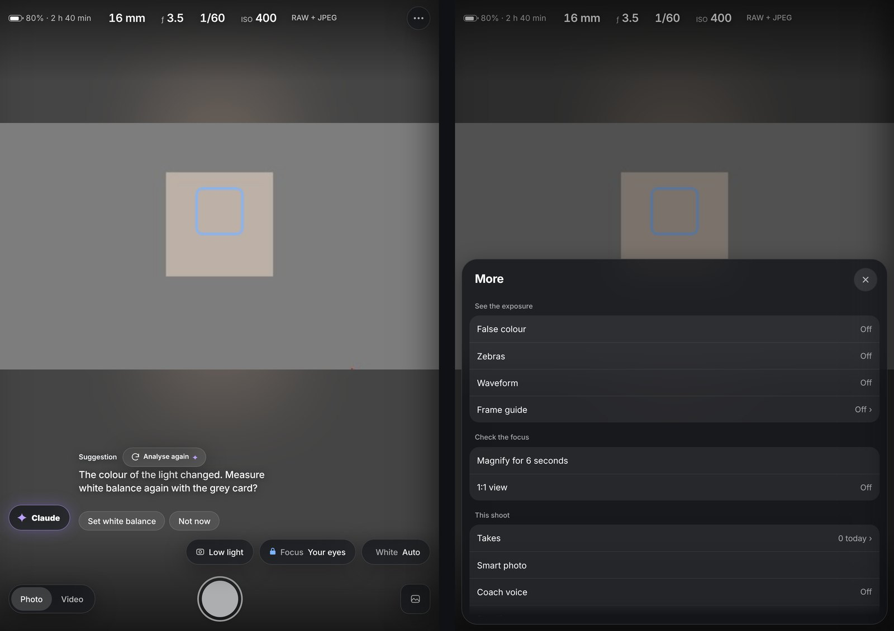

## 14. What Studio never does

- It never takes a photo or starts a recording without your press.
- It never changes a setting by itself after it locked; suggestions wait for your tap.
- It never asks Claude in the background, and never sends anything without your press.
- It never changes or deletes anything on the card, and never changes your original files.
- It never installs drivers and never changes firewall or network settings.

What is tested on a real camera and what is still to be confirmed is listed in the [README](../README.md).
